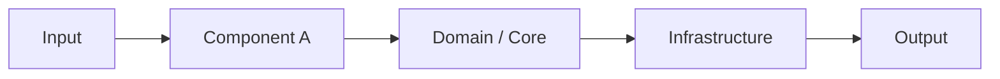

# ARCHITECTURE

This document describes the architecture that exists now.

It is not a speculative design document for every feature the project may eventually contain.

## Current scope

```text
Current stage:
What architecture this document currently covers:
What is intentionally outside the current boundary:
```

## System overview

Use the simplest useful diagram.

Example:



Replace the example with the actual project flow.

## Components and responsibilities

### `{{COMPONENT_A}}`

Responsibility:

```text
...
```

Owns:

```text
...
```

Does not own:

```text
...
```

### `{{COMPONENT_B}}`

Responsibility:

```text
...
```

## Data flow

Show where important values originate, how they change, and where they end.

```text
input
    -> parser/adapter
    -> internal model
    -> transformation
    -> output
```

Use real project terminology.

## State, ownership, and lifetime

For resources/state with lifetime concerns, document:

```text
Who creates it?
Who owns it?
How long does it live?
Who releases/disposes/unsubscribes it?
What happens on partial failure?
What concurrency/threading rules apply?
```

Skip this section when the project genuinely has no such concerns.

## External dependencies

For each architecturally relevant dependency:

```text
Dependency:
Version:
Responsibility:
Why external:
Important constraints:
Replacement cost / coupling:
```

Do not list every package—only dependencies that affect architecture.

## Invariants

Record properties that must remain true across changes.

```text
- ...
- ...
```

## Known limitations

```text
- ...
```

## Architecture changes

When a change creates a new stable architectural rule:

```text
1. Update implementation.
2. Verify behavior.
3. Record the decision in DECISIONS.md when appropriate.
4. Update this document to reflect the architecture that now exists.
```
